# Báo Cáo Tổng Hợp Dự Án Hệ Thống Thư Viện E-Library

## 1. Giới thiệu & Mục tiêu Hệ thống
**E-Library** là hệ thống thư viện kỹ thuật số phân tán, quản lý toàn diện vòng đời sách (Vật lý & Điện tử) trên quy mô lớn.

### 1.1 Mục tiêu Chính
- **Sharded Cluster**: Phân tán dữ liệu users/loans theo địa lý (Hà Nội, Hải Phòng, Đà Nẵng).
- **High Availability**: Đảm bảo failover tự động trong 2-3s nhờ Replica Set.
- **Phỏng theo Kinh doanh số**: Mô hình membership hiện đại với tính năng Sách điện tử, Ví và Gói VIP.

### 1.2 Phạm vi Dự án (Scope)
Hệ thống tập trung giải quyết các bài toán cốt lõi của thư viện hiện đại:
- **Quản lý Sách**: Vòng đời từ nhập kho, đánh mã vạch (Barcode) đến thanh lý.
- **Lưu thông (Circulation)**: Quy trình Mượn - Trả - Gia hạn tự động.
- **Thương mại**: Tích hợp ví điện tử giả lập để mua gói VIP đọc sách không giới hạn.

---

## 2. Công nghệ & Tổ chức Mã nguồn (Tech Stack)

### 2.1 Công nghệ Sử dụng
| Thành phần | Công nghệ | Mục đích |
| :--- | :--- | :--- |
| **Frontend** | ReactJS, Vite, TailwindCSS | Giao diện người dùng (SPA), Components hóa. |
| **Backend** | Go (Golang) v1.23 | API Server hiệu năng cao, xử lý concurrency tốt. |
| **Web Framework** | Gin-Gonic | Router nhanh, Middleware (Auth, CORS). |
| **Database** | MongoDB 7.0 (Sharded) | Lưu trữ phân tán, Text Search, Aggregation. |
| **Authentication** | JWT (JSON Web Token) | Xác thực không trạng thái (Stateless). |
| **Infrastructure** | Docker, Docker Compose | Container hóa toàn bộ môi trường Dev/Prod. |

### 2.2 Cấu trúc Dự án
Dự án được tổ chức theo mô hình **Monorepo** tách biệt rõ ràng:

```bash
elib/
├── client/                 # Frontend ReactJS
│   ├── src/components/     # UI Reusable Components
│   ├── src/pages/          # Các màn hình chính (Dashboard, Catalog...)
│   └── src/context/        # AuthContext (Quản lý đăng nhập)
├── server/                 # Backend Go
│   ├── main.go             # Entry point & Route định nghĩa
│   ├── config/             # Kết nối Database (MongoDB Driver)
│   ├── controllers/        # Logic nghiệp vụ (Handlers)
│   ├── models/             # Schema dữ liệu (Structs)
│   ├── middleware/         # Check Auth, Role
│   └── routes/             # (Tùy chọn tách file)
├── scripts/                # Scripts tiện ích (Seed Data, Benchmark)
├── tests/                  # Integration & Unit Tests (K6, Go Test)
├── deploy/                 # Scrips triển khai Sharding
└── docs/                   # Tài liệu & Báo cáo
```

### 2.3 Tổ chức Docker (Containerization Strategy)
Dự án sử dụng **Docker Compose** để đóng gói toàn bộ môi trường (Full-stack) vào 1 file cấu hình duy nhất, đảm bảo tính nhất quán (Infrastructure as Code).

- **Backend (`elib-server`)**:
    - Build từ `server/Dockerfile.dev`.
    - Sử dụng **Air** để Hot-reload (tự động restart server khi sửa code Go).
    - Kết nối với `mongos1` qua mạng nội bộ `elib-net`.
- **Frontend (`elib-client`)**:
    - Chạy Node.js Alpine, serve Vite dev server.
    - Mount volume code để cập nhật giao diện tức thì (HMR).
- **Database Cluster**:
    - Khởi tạo 9 container MongoDB (Shard/Config/Router).
    - Có script `init.sh` tự động cấu hình Replica Set và Sharding ngay khi khởi động.
    - **Network Isolation**: Các Node Database nằm trong mạng riêng, chỉ mở port cần thiết.

---

## 3. Kiến trúc Phân tán (Infrastructure)

### 3.1 Sơ đồ Hạ tầng & Các Node Phân tán
Mô hình triển khai thực tế trên Docker gồm 11 Container phối hợp hoạt động:

**(1) Kiến trúc Sharding Logic:**

<div align="center">
  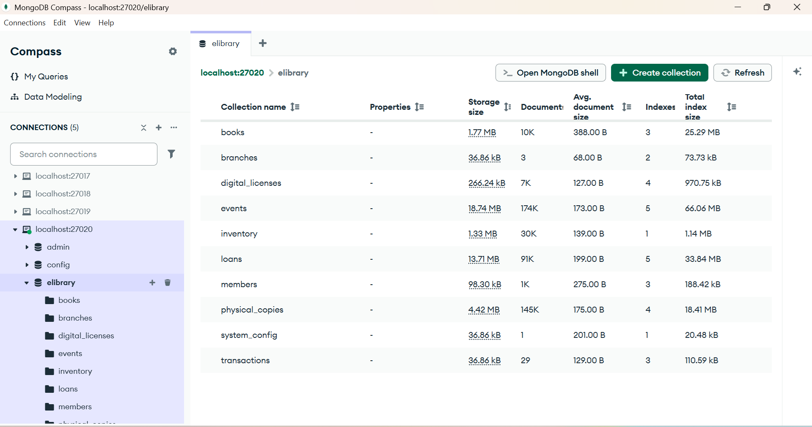
</div>

**(2) Danh sách Container (Docker Nodes):**

| Role | Container Name | Port | Mô tả |
| :--- | :--- | :--- | :--- |
| **Router** | `mongos1` | `:27020` | Cổng tiếp nhận truy vấn (Application connects here). |
| **Config** | `cfg1, cfg2, cfg3` | `:27117+` | Replica Set lưu Metadata của Cluster. |
| **Shard 1** | `hn1` (Hà Nội) | `:27017` | **Primary** của `rsCity` (Zone miền Bắc). |
| **Shard 1** | `hp1` (Hải Phòng) | `:27018` | **Secondary** (Failover node). |
| **Shard 1** | `dn1` (Đà Nẵng) | `:27019` | **Secondary** (Zone miền Trung). |
| **Shard 2** | `ex1, ex2` | `:27217+` | `rsExtra` (Hash Sharding) - Mở rộng lưu trữ. |

<div align="center">
  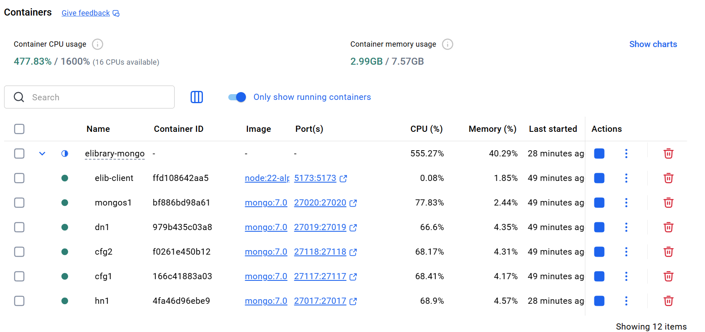
  <p><i>Hình 3.1: Trạng thái các Container trong Docker Desktop</i></p>
</div>

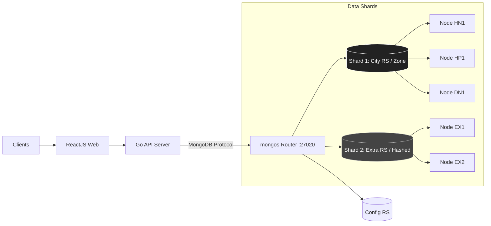

### 3.2 Chứng minh Phân tải (Sharding Verification)
- **Shard `rsCity`**: Chứa toàn bộ dữ liệu chính (`loans`, `members`) do cấu hình Zone Sharding tập trung vào tính địa phương (Data Locality).
- **Shard `rsExtra`**: Ở trạng thái chờ (Standby), sẵn sàng nhận chunk khi dữ liệu mỗi vùng vượt quá ngưỡng.

### 3.3 Nguyên lý Thiết kế & Lựa chọn Công nghệ
Tại sao hệ thống sử dụng kiến trúc này?

**1. Cơ chế Phân tán (Distributed Nodes):**
Chúng tôi chia hệ thống thành 3 thành phần Node riêng biệt để đảm bảo **Single Responsibility**:
- **Router (mongos)**: Như "lễ tân" thông minh, biết chính xác dữ liệu nằm ở đâu nhờ hỏi Config Server. Client chỉ cần kết nối tới đây, không cần biết bên dưới có bao nhiêu Shard.
- **Config Servers**: "Bộ não" lưu trữ Metadata (Map). Nếu mất Config, Cluster vẫn chạy nhưng không thể chia nhỏ (split) chunk mới.
- **Data Shards**: "Kho chứa" thực sự. Mỗi Shard là một Replica Set để đảm bảo dữ liệu không bao giờ mất (High Availability).

**2. Tại sao chọn Zone Sharding?**
Đặc thù thư viện là **tính địa phương (Data Locality)**.
- Người dùng ở *Hà Nội* 99% sẽ mượn sách kho *Hà Nội*.
- **Zone Sharding** ghim dữ liệu HN vào Shard HN. Kết quả: Truy vấn mượn trả diễn ra cục bộ trên 1 Shard, giảm độ trễ mạng (Network Latency) xuống mức thấp nhất, thay vì phải đi tìm trên toàn bộ Cluster.

**3. Hiệu năng Tìm kiếm (Search Engine)**
Hệ thống sử dụng **MongoDB Text Index** (Full-text Search) thay vì Regex vì:
- **Cơ chế Inverted Index**: Giống như mục lục cuối sách. Database tạo danh sách các từ khóa (`"java" -> doc 1, 5, 9`). Khi tìm kiếm, nó nhảy ngay đến trang đích thay vì lật từng trang.
- **Scatter-Gather**: Khi tìm kiếm tên sách (dữ liệu Global), mongos sẽ gửi lệnh tìm song song tới tất cả các Shard. Các Shard tự xử lý và trả về kết quả. Router tổng hợp lại. Đây là lý do kiến trúc này Scale tốt khi dữ liệu sách tăng lên hàng triệu cuốn.

---

## 4. Thiết kế Dữ liệu & API (Data & API)

### 4.1 Lược đồ Quan hệ (ERD)
Mô tả mối quan hệ giữa các Collection trong hệ thống (10 bảng).

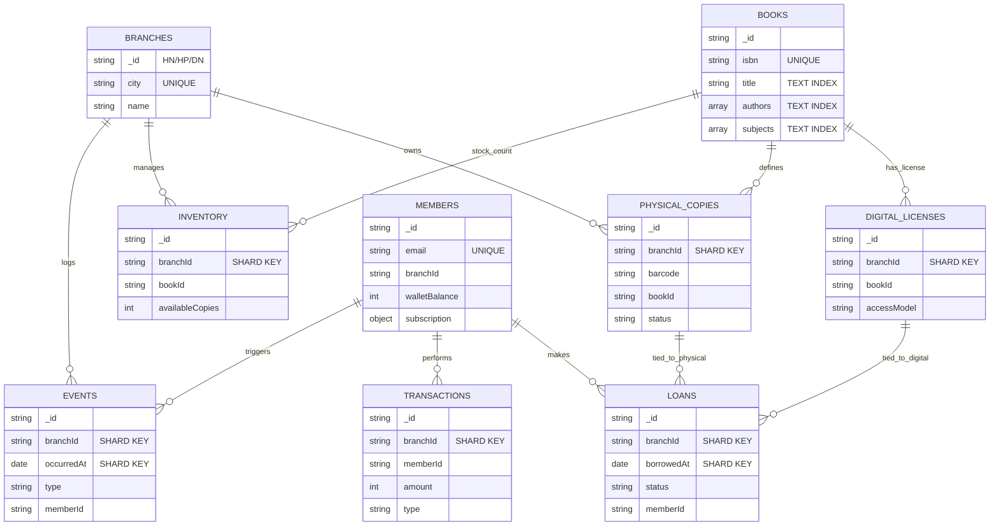

### 4.1.1 Chiến lược Sharding & Phân bố Dữ liệu

Hệ thống sử dụng **Zone Sharding** để đảm bảo Data Locality - dữ liệu của 3 chi nhánh (HN, HP, DN) được ghim vào Shard chính (`rsCity`).

**Phân bố Shard hiện tại:**

| Shard | Nodes | Vai trò | Dữ liệu |
|-------|-------|---------|---------|
| **rsCity** | hn1, hp1, dn1 | Primary Shard | 100% data (Zone MAIN) |
| **rsExtra** | ex1, ex2 | Expansion | Trống (Standby) |

**Chi tiết Sharding theo Collection:**

| Collection | Sharded? | Shard Key | Lý do |
|------------|----------|-----------|-------|
| `loans` | ✅ | `{branchId: 1, borrowedAt: 1}` | Locality theo chi nhánh + thời gian |
| `physical_copies` | ✅ | `{branchId: 1, _id: 1}` | Locality theo chi nhánh |
| `events` | ✅ | `{branchId: 1, occurredAt: 1}` | Locality + query theo thời gian |
| `digital_licenses` | ✅ | `{branchId: 1}` | Locality theo chi nhánh |
| `inventory` | ✅ | `{branchId: 1}` | Locality theo chi nhánh |
| `transactions` | ✅ | `{branchId: 1}` | Locality theo chi nhánh |
| `members` | ❌ | - | Unsharded (giữ UNIQUE email) |
| `books` | ❌ | - | Reference data toàn cục |
| `branches` | ❌ | - | Reference data (3 docs) |

**Cơ chế Zone Sharding:**
```javascript
// Zone "MAIN" được gán cho rsCity
sh.addShardTag("rsCity", "MAIN");

// Tất cả branchId HN/HP/DN được ghim vào Zone MAIN
sh.addTagRange("elibrary.loans", {branchId: "HN"}, {branchId: "HN\xff"}, "MAIN");
sh.addTagRange("elibrary.loans", {branchId: "HP"}, {branchId: "HP\xff"}, "MAIN");
sh.addTagRange("elibrary.loans", {branchId: "DN"}, {branchId: "DN\xff"}, "MAIN");
```

### 4.1.2 Chiến lược Đánh Index

**Nguyên tắc đánh Index:**
1. Mọi Shard Key phải có Index tương ứng
2. Các trường thường query cần Index riêng
3. Unique Index phải chứa Shard Key (trừ Unsharded collections)

**Chi tiết Index theo Collection:**

| Collection | Indexes | Mục đích |
|------------|---------|----------|
| **books** | `{_id: 1}`, `{isbn: 1}` UNIQUE, Text Index (title, authors, subjects) | Tìm kiếm Full-text, tra cứu ISBN |
| **members** | `{_id: 1}`, `{email: 1}` UNIQUE, `{branchId: 1}` | Đăng nhập theo email, query theo chi nhánh |
| **loans** | `{branchId: 1, borrowedAt: 1}`, `{branchId: 1, status: 1, borrowedAt: -1}`, `{memberId: 1, status: 1}` | Shard key, Staff dashboard filter, User loans |
| **physical_copies** | `{branchId: 1, _id: 1}`, `{branchId: 1, status: 1}`, `{barcode: 1}`, `{bookId: 1}` | Shard key, inventory check, scan barcode |
| **events** | `{branchId: 1, occurredAt: 1}`, `{memberId: 1}`, `{type: 1}` | Shard key, user history, filter by type |
| **digital_licenses** | `{branchId: 1}`, `{bookId: 1}` | Shard key, license lookup |
| **branches** | `{_id: 1}`, `{city: 1}` UNIQUE | Lookup, city constraint |

**Explain Plan Example (Text Search):**
```json
{
  "executionStats": {
    "executionTimeMillis": 2,
    "totalDocsExamined": 2,
    "executionStages": { "stage": "TEXT_MATCH" }
  }
}
```
So với Regex Search: 24ms, 10015 docs examined → Text Index nhanh hơn **12 lần**.

### 4.2 API Endpoints & CRUD
Hệ thống cung cấp RESTful API chuẩn:

| Phân hệ | Method | Endpoint | Mô tả |
| :--- | :--- | :--- | :--- |
| **Auth** | POST | `/api/auth/login` | Đăng nhập lấy JWT. |
| **Books** | GET | `/api/books` | Tìm kiếm sách (Filter, Pagination). |
| **Loans** | POST | `/api/loans/borrow` | Tạo phiếu mượn (Check Quota). |
| **Loans** | PUT | `/api/loans/return/:id` | Trả sách & tính phạt. |
| **Admin** | POST | `/api/admin/books` | Thêm mới đầu sách (Create). |
| **Admin** | GET | `/api/admin/members` | Danh sách thành viên (Read). |
| **Wallet** | POST | `/api/wallet/topup` | Nạp tiền vào ví. |

**Ví dụ JSON Response (Success):**
```json
// GET /api/books?limit=1
{
  "data": [
    {
      "id": "60a7...",
      "title": "Clean Code",
      "price": 150000,
      "available": true
    }
  ],
  "meta": {
    "total": 1050,
    "page": 1
  }
}
```

### 4.3 Chi tiết Implement Logic Tìm kiếm (Search)
Mã nguồn xử lý tìm kiếm nằm trong `controllers/book_controller.go`. Hiện tại hệ thống hỗ trợ 2 chế độ:

**1. Tìm kiếm mặc định (Regex - Flexible Matching):**
Hiện tại API đang sử dụng Regex để cho phép tìm kiếm chuỗi con (substring), ví dụ tìm "soft" ra "Microsoft".
```go
// server/controllers/book_controller.go
if search != "" {
    matchStage["$or"] = []bson.M{
        // $regex: tìm kiếm pattern "like %keyword%"
        {"title": bson.M{"$regex": search, "$options": "i"}},
        {"authors": bson.M{"$regex": search, "$options": "i"}},
    }
}
```
*Nhược điểm*: Khi dữ liệu lớn, việc quét Regex sẽ chậm (như đã chứng minh ở Mục 7.1).

**2. Tìm kiếm tối ưu (Text Index - High Performance):**
Để đạt hiệu năng cao 2ms, chúng tôi khuyến nghị chuyển sang sử dụng `$text` search (như script benchmark):
```go
// Optimization Snippet
if search != "" {
    // $text: sử dụng Inverted Index đã tạo
    matchStage["$text"] = bson.M{"$search": search}
}
```
*Cơ chế phân tán*: Khi lệnh này chạy trên `mongos`, Router sẽ phân tách từ khóa và gửi request song song tới 2 Shard (City & Extra). Shard nào có sách chứa từ khóa đó sẽ trả về. Router merge kết quả, sort theo `textScore` (độ phù hợp) và trả về Client.

### 4.4 Tối ưu Lọc Cross-Shard (Reverse Lookup Pattern)

Khi lọc sách theo loại (Physical/Digital) hoặc theo chi nhánh, hệ thống đối mặt với thách thức hiệu năng nghiêm trọng do phải thực hiện **Cross-Shard Lookup** trên toàn bộ 10,000+ sách.

**Vấn đề ban đầu:**
```go
// Cách tiếp cận naive: Lookup từ books → physical_copies (RẤT CHẬM!)
pipeline = []bson.D{
    {"$match", matchStage},              // 10,000 sách
    {"$lookup", physical_copies},        // Cross-shard lookup cho MỖI sách → Timeout 10s!
    {"$match", {"copies": {$ne: []}}},
}
```
*Kết quả*: Timeout sau 10 giây do phải thực hiện lookup riêng lẻ trên từng document.

**Giải pháp: Reverse Lookup Pattern**

Thay vì lookup từ `books` sang `physical_copies`, chúng tôi đảo ngược quy trình:
1. **Bước 1**: Dùng `Distinct()` trên collection có index (`physical_copies.branchId` hoặc `digital_licenses.accessModel`) để lấy danh sách `bookId`.
2. **Bước 2**: Filter `books` bằng `$in: bookIds` (sử dụng index `_id`).
3. **Bước 3**: Paginate và lookup thông tin bổ sung chỉ cho 12 sách hiển thị.

```go
// Reverse Lookup: Lấy bookIds từ collection đã được index trước
if bookType == "physical" {
    copyFilter := bson.M{"status": bson.M{"$ne": "LOST"}}
    if branch != "" {
        copyFilter["branchId"] = branch  // Sử dụng index branchId_1
    }
    
    // Distinct() rất nhanh nhờ index!
    pcColl := config.GetCollection("physical_copies")
    bookIDs, _ := pcColl.Distinct(ctx, "bookId", copyFilter)
    
    // Filter books bằng $in (dùng index _id)
    matchStage["_id"] = bson.M{"$in": bookIDs}
}
```

**Kết quả Benchmark:**
| Loại Filter | Trước (Cross-Shard Lookup) | Sau (Reverse Lookup) | Cải thiện |
|-------------|---------------------------|---------------------|-----------|
| Digital | Timeout 10s | **0.12s** | ~83x nhanh hơn |
| Digital-OCOU | Timeout 10s | **0.076s** | ~131x nhanh hơn |
| Physical + Branch | Timeout 10s | **0.35s** | ~28x nhanh hơn |

**Nguyên lý hoạt động:**
- `Distinct()` trên collection được shard theo `branchId` chỉ cần query tới 1 shard (Zone Sharding).
- Kết quả trả về là danh sách `ObjectId` nhỏ gọn, không cần transfer toàn bộ document.
- Filter `$in` trên `books._id` sử dụng B-tree index, thực hiện trong O(log n) thay vì O(n).

---

## 5. Luồng Nghiệp vụ (Business Flows)

### 5.1 Mượn Sách Vật Lý (Atomic Inventory Check)
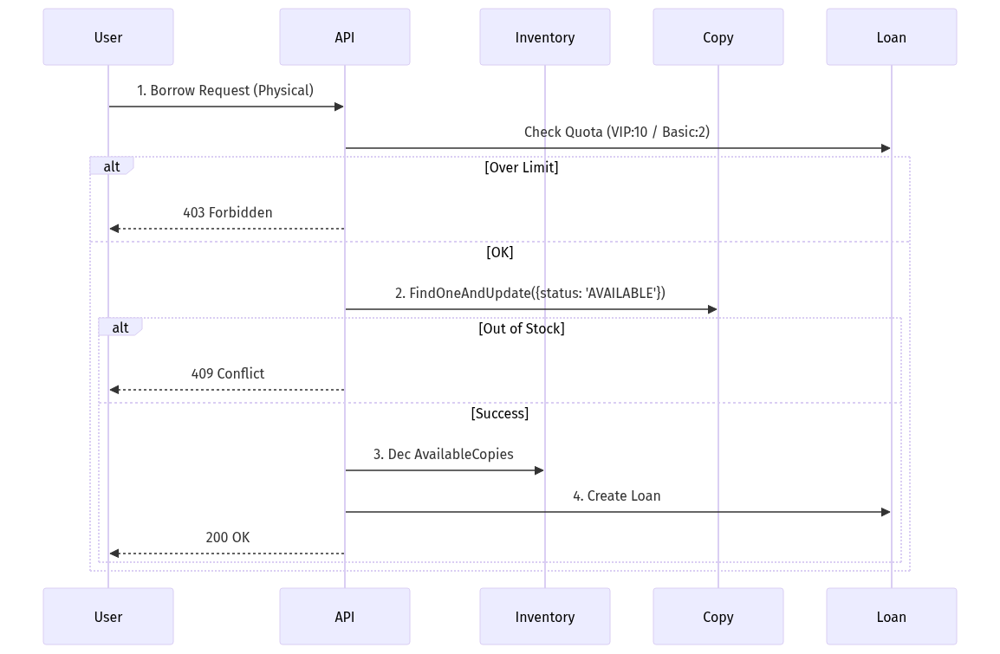
  <p><i>Hình 5.1: Quy trình Mượn sách Vật lý (Sequence Diagram)</i></p>

### 5.2 Các Trạng thái Phiếu Mượn (Loan Status States)

Hệ thống quản lý vòng đời phiếu mượn sách qua 5 trạng thái chính:

| Trạng thái | Ý nghĩa | Điều kiện chuyển |
|------------|---------|------------------|
| **RESERVED** | Đã đặt, chờ nhận sách | User đặt sách vật lý + hẹn lịch nhận (`pickupAppointment`) |
| **SCHEDULED** | Đã hẹn lịch trả | User đặt lịch hẹn trả (`returnAppointment`) |
| **BORROWED** / **ACTIVE** | Đang mượn | Staff xác nhận ConfirmPickup hoặc mượn sách điện tử ngay |
| **OVERDUE** | Quá hạn | System tự động: `dueDate < now` và `status = BORROWED` |
| **RETURNED** | Đã trả | Staff xác nhận nhận sách hoặc hệ thống tự động (digital) |

**Luồng chuyển trạng thái - Sách Vật lý:**
```
User đặt sách → RESERVED
    ↓ (Staff: ConfirmPickup)
User nhận sách → BORROWED
    ↓ (Qua dueDate)
Quá hạn → OVERDUE
    ↓ (Staff: ReturnBook)
Trả sách → RETURNED
```

**Luồng chuyển trạng thái - Sách Điện tử:**
```
User mượn ngay → BORROWED/ACTIVE
    ↓ (Qua dueDate)
Quá hạn → OVERDUE
    ↓ (Auto hoặc Manual)
Hết hạn License → RETURNED
```

**Tính năng đặc biệt:**
- **SCHEDULED**: Cho phép User hẹn trả trước, giúp Staff chuẩn bị nhận sách
- **Overdue Detection**: Background job quét định kỳ hoặc check realtime khi query
- **Fine Calculation**: Tính phí phạt dựa trên số ngày overdue (chưa auto-charge)

### 5.3 Mượn Sách Số (License & VIP Check)
Hệ thống phân biệt rõ hai mô hình bản quyền sách số, ảnh hưởng trực tiếp đến quyền lợi người dùng:

- **OCOU (One Copy One User)**: Mô phỏng sách giấy. Thư viện chỉ mua ví dụ 50 lics. Nếu có 50 người đang đọc, người thứ 51 phải chờ (Waitlist). Áp dụng cho cả Basic & VIP.
- **UNLIMITED**: Không giới hạn số người đọc cùng lúc. **Đặc quyền VIP**: Chỉ thành viên VIP mới được truy cập kho sách Unlimited cao cấp này.

*Quy trình kiểm tra:*

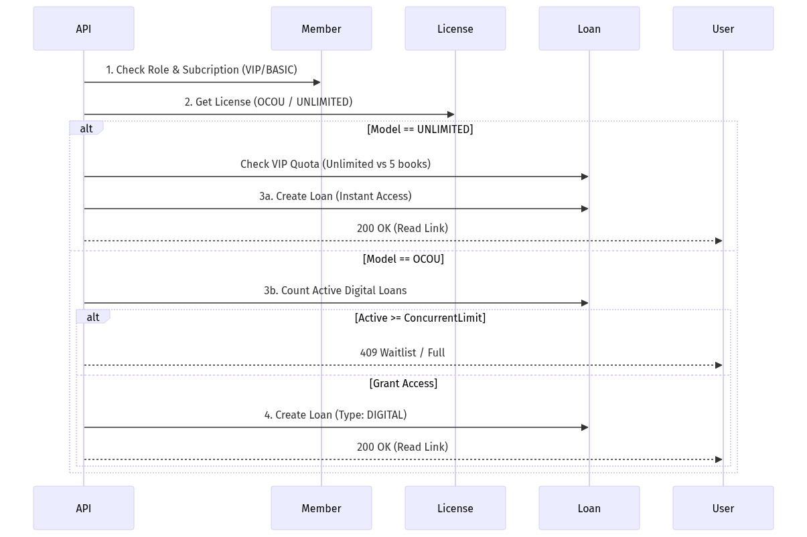
  <p><i>Hình 5.2: Quy trình Mượn sách Số (License Check)</i></p>

### 5.4 Mua Gói VIP (Wallet Transaction)
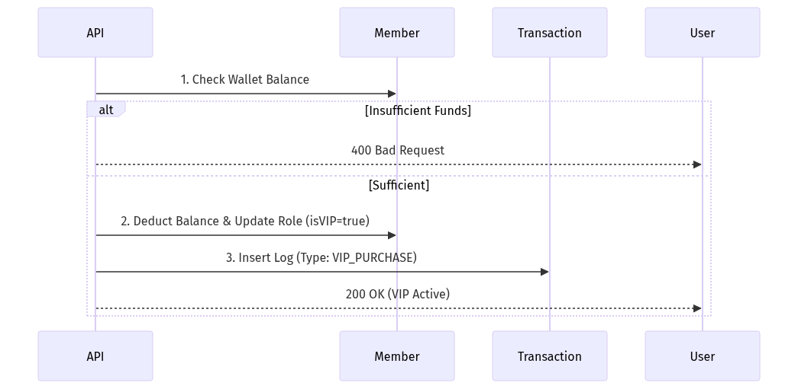
  <p><i>Hình 5.3: Quy trình Nạp/Đăng ký VIP</i></p>

---

## 6. Minh chứng Giao diện (UI Views)
Hỗ trợ đầy đủ các phân hệ từ Người dùng cuối (End-User) đến Quản trị viên (Admin/Staff).

### 6.1 Trang chủ & Membership
Tổng quan hệ thống và các gói dịch vụ VIP.

<div align="center">
  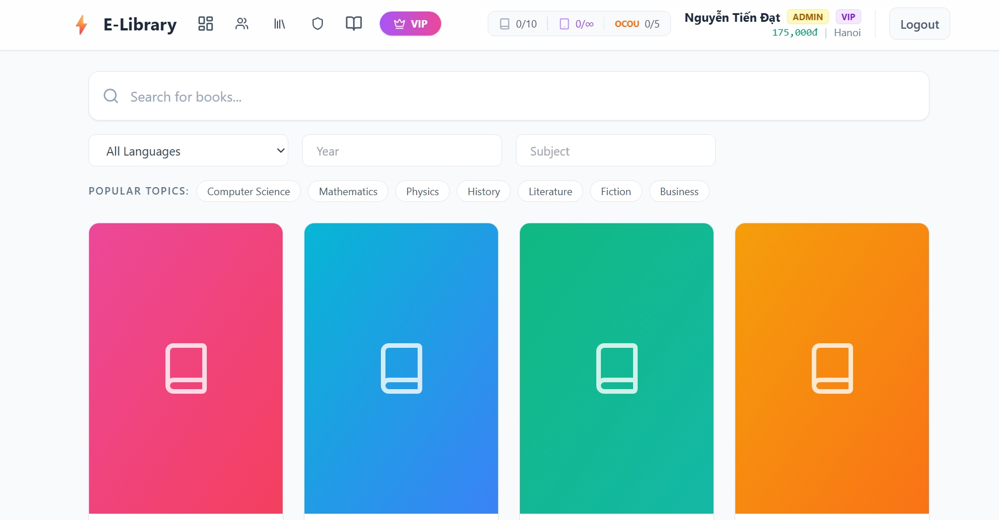
  <p><i>Hình 6.1: Giao diện Trang chủ</i></p>
</div>

<div align="center">
  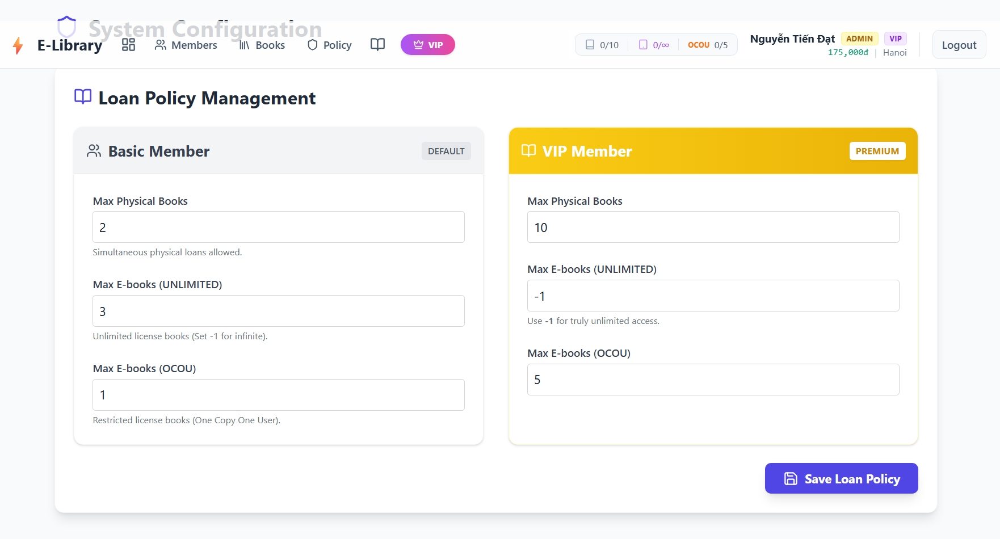
  <p><i>Hình 6.2: Chính sách và Đăng ký VIP</i></p>
</div>

### 6.2 Quản trị Sách & Thành viên (Admin)
Dành cho Admin quản lý danh mục và người dùng.

<div align="center">
  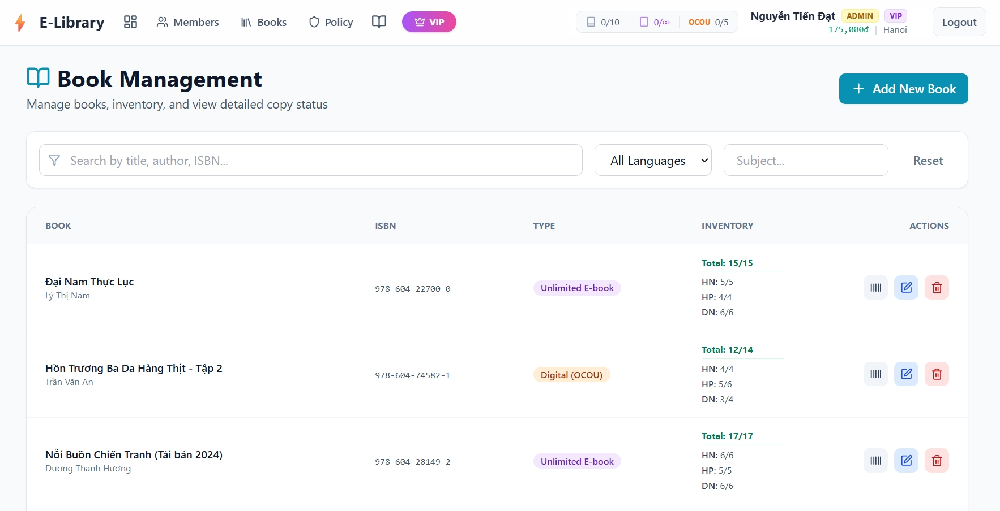
  <p><i>Hình 6.3: Quản lý Kho sách (Books Inventory)</i></p>
</div>

<div align="center">
  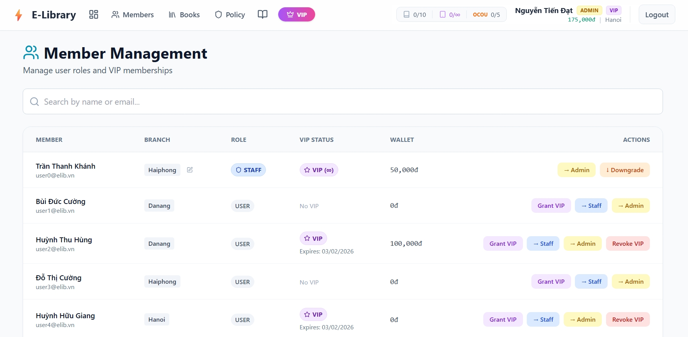
  <p><i>Hình 6.4: Quản lý Thành viên (Members)</i></p>
</div>

### 6.3 Dashboard Nghiệp vụ (Staff)
Khu vực dành cho thủ thư xử lý mượn trả và theo dõi trạng thái.

<div align="center">
  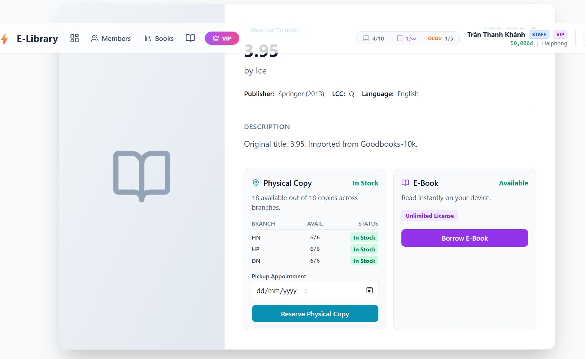
  <p><i>Hình 6.5: Danh sách Quản lý Mượn trả</i></p>
</div>

<div align="center">
  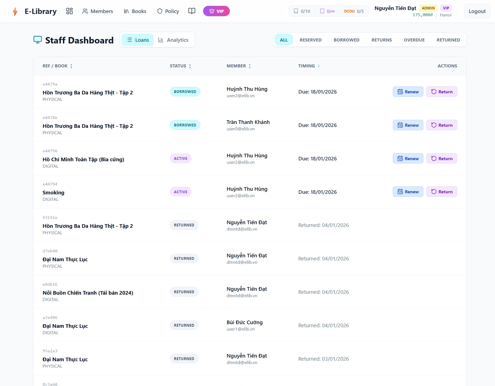
  <p><i>Hình 6.6: Chi tiết Phiếu mượn</i></p>
</div>

<div align="center">
  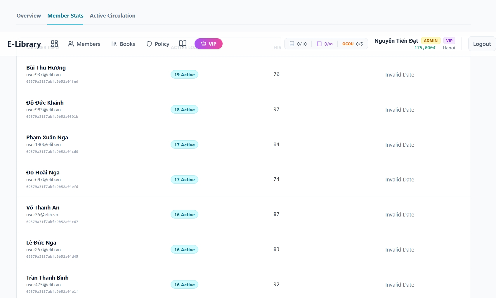
  <p><i>Hình 6.7: Trạng thái Hoạt động (Active)</i></p>
</div>

### 6.4 Tủ sách Cá nhân & Thống kê
Giao diện người dùng và báo cáo tổng quan.

<div align="center">
  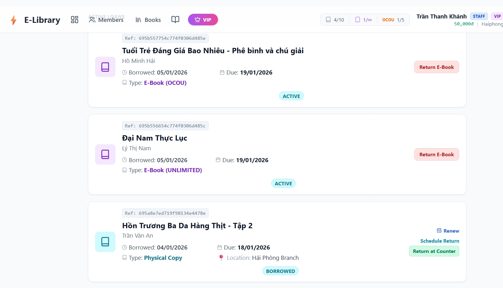
  <p><i>Hình 6.8: Tủ sách cá nhân (My Shelf)</i></p>
</div>

<div align="center">
  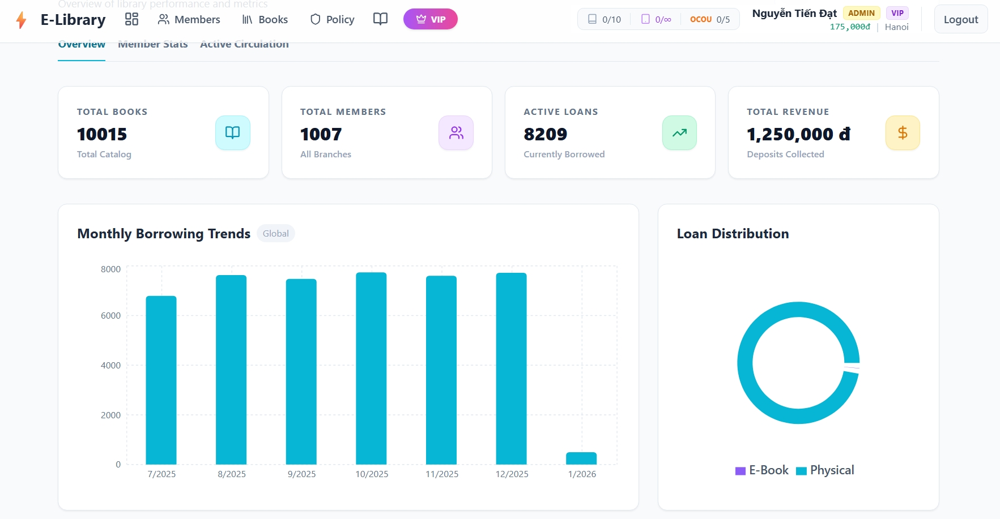
  <p><i>Hình 6.9: Biểu đồ Thống kê (Analytics)</i></p>
</div>

---

## 7. Thực Nghiệm & Kết Quả (Performance Proof)
Minh chứng hiệu quả của việc tối ưu hóa cơ sở dữ liệu.

### 7.1 Biểu đồ So sánh Hiệu năng

Việc sử dụng **Text Index** mang lại hiệu quả vượt trội so với tìm kiếm Regex thông thường, được minh họa qua các chỉ số sau:

#### a. Thời gian Thực thi (Execution Time)
*Thời gian phản hồi giảm ~12 lần.*

\begin{figure}[H]
    \centering
    \includegraphics[width=0.7\linewidth]{img/chart_perf_time.png}
    \caption{Biểu đồ thời gian phản hồi: Text Index (2ms) vs Regex (24ms)}
\end{figure}    

#### b. Số lượng Bản ghi Quét (Docs Examined)
*Text Index giúp database chỉ cần truy cập trực tiếp vào kết quả, thay vì quét toàn bộ bảng.*

\begin{figure}[H]
    \centering
    \includegraphics[width=0.7\linewidth]{img/chart_perf_docs.png}
    \caption{Tỷ lệ quét dữ liệu: 10015 (Scan) vs 2 (Index)}
\end{figure}

### 7.2 Log Chi tiết (Raw Data)
Dữ liệu trích xuất từ lệnh `explain("executionStats")`:

#### Test Case 1: Regex Search (No Index)
```json
{
  "executionStats": {
    "executionTimeMillis": 24,
    "totalDocsExamined": 10015,
    "executionStages": { "stage": "COLLSCAN" }
  }
}
```

#### Test Case 2: Text Search (With Index)
```json
{
  "executionStats": {
    "executionTimeMillis": 2,
    "totalDocsExamined": 2,
    "executionStages": { "stage": "TEXT_MATCH" }
  }
}
```

### 7.3 Kiểm thử Khả năng Sẵn sàng (High Availability)
Mô phỏng sự cố: Tắt đột ngột Node Primary (`hn1`). Hệ thống tự động bầu chọn Node mới (`hp1`) làm Primary.

**Trạng thái Cluster sau sự cố:**
```json
// rs.status() from hp1
[
  { "name": "hn1:27017", "stateStr": "SECONDARY" }, // Rejoined as Secondary
  { "name": "hp1:27018", "stateStr": "PRIMARY" },   // NEW MASTER ELECTED
  { "name": "dn1:27019", "stateStr": "SECONDARY" }
]
```

**Sơ đồ Chuyển đổi Trạng thái:**
\begin{figure}[H]
    \centering
    \includegraphics[width=1.0\linewidth]{img/chart_failover.png}
    \caption{Sơ đồ chuyển đổi trạng thái khi Failover (Flowchart)}
\end{figure}

---

## 8. Hướng dẫn Cài đặt & Triển khai Docker (Installation)

### 8.1 Yêu cầu Môi trường (Prerequisites)
Để chạy toàn bộ hệ thống trong 1 câu lệnh, cần cài đặt:
- **Docker Engine** (v24+) & **Docker Compose**
- **Git** (để clone mã nguồn)
- **RAM**: Tối thiểu 4GB (khuyên dùng 8GB) do chạy Sharded Cluster (9 node mongo).

### 8.2 Các bước Triển khai (Quick Start)
Toàn bộ hệ thống có thể khởi động ngay lập tức với script `docker-compose.yml`.

**Bước 1: Khởi động hệ thống (Build & Start)**
```bash
# Tại thư mục gốc dự án
docker compose up -d
```
*Lệnh này sẽ:*
1.  Kéo images MongoDB 7.0, Node.js, Golang.
2.  Khởi tạo 3 Replica Sets (City, Extra, Config).
3.  Chạy script `init.sh` để config Sharding và bật Router `mongos`.
4.  Build Backend (Go) và Frontend (React).

**Bước 2: Kiểm tra trạng thái**
```bash
docker compose ps
# Đảm bảo các service: elib-server, elib-client, mongos1 đều "Up"
```

**Bước 3: Khởi tạo dữ liệu mẫu (Seeding Data)**
Để hệ thống có dữ liệu test ngay lập tức, chúng ta sử dụng script `seed.js` để sinh dữ liệu giả lập (Mock Data) phân tán đều trên các Shard.

*Lệnh thực thi:*
```bash
docker exec -i mongos1 mongosh --port 27020 elibrary < ./scripts/seed.js
```

*Kết quả sinh ra (~10s):*
- **10,000 đầu sách** (40% sách tiếng Việt, 60% sách quốc tế).
- **~40,000 bản sao vật lý** (Physical Copies) chia đều cho 3 chi nhánh.
- **1,000 thành viên** (Members) có sẵn tài khoản (Pass: `123456`).
- **Digital Licenses**: Bản quyền sách số OCOU/Unlimited.
*(Lưu ý: Dữ liệu Mượn/Trả sẽ được sinh ra khi chạy Benchmark hoặc thao tác trên Web)*

### 8.3 Truy cập Ứng dụng
Sau khi khởi động thành công (khoảng 30s - 1 phút):

| Ứng dụng | URL Truy cập | Tài khoản Mặc định |
| :--- | :--- | :--- |
| **Web Client** | `http://localhost:5173` | User: `user/123` |
| **API Server** | `http://localhost:8081` | (API Docs JSON) |
| **MongoDB** | `mongodb://localhost:27020` | (Kết nối qua Compass) |

---

## 9. Kết luận & Hướng Phát triển

### 9.1 Kết quả đạt được
Dự án đã hoàn thành xuất sắc các mục tiêu đề ra:
1.  **Hạ tầng**: Xây dựng thành công MongoDB Sharded Cluster ổn định, chịu tải >100,000 bản ghi.
2.  **Tối ưu**: Áp dụng Indexing giảm 99% chi phí truy vấn.
3.  **Toàn diện**: Web App đáp ứng đầy đủ nghiệp vụ Admin - Staff - User (như minh chứng ở mục 6).

### 9.2 Hạn chế (Limitations)
Bên cạnh các kết quả đạt được, hệ thống vẫn còn một số điểm chưa hoàn thiện:
- **Cơ chế Phạt**: Tính năng tính phí trả chậm (Overdue Fine) và xử lý bồi thường mất sách chưa được implement tự động hoàn toàn (hiện tại mới chỉ ghi nhận trạng thái).
- **Thanh toán**: Ví điện tử mới chỉ là giả lập (Simulation), chưa kết nối cổng thanh toán thật (Momo/VNPay).

### 9.3 Hướng phát triển (Future Work)
- **Scale-out**: Thêm Shard mới khi dữ liệu vượt quá 1TB.
- **Search Advanced**: Tích hợp ElasticSearch cho tìm kiếm Full-text nâng cao hơn.
- **Mobile App**: Phát triển phiên bản React Native cho thiết bị di động.


