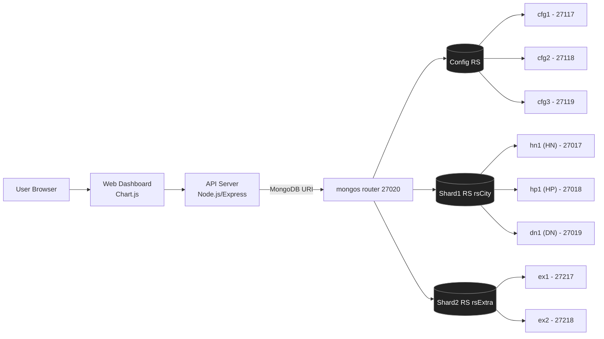

# Kế hoạch thực thi dự án e-Library phân tán 3 thành phố (MongoDB Sharding + Replica Set + Failover)

## B) Kiến trúc triển khai (Docker Compose + mô phỏng 3 thành phố)

### Mục tiêu kiến trúc

* **Sharded Cluster** (có `mongos` + `config servers`) để bật sharding cho các collection cần phân tán.
* **Replica Set cho shard chính** gồm **3 node tương ứng 3 thành phố** (**HN, HP, DN**) để **failover thật** (tắt 1 container vẫn chạy).
* Có thể thêm **shard phụ** (ít nhất 1) để chứng minh dữ liệu được “shard” (không chỉ cấu hình hình thức).

### Sơ đồ kiến trúc (Mermaid)



### Container / network / ports (gợi ý rõ để đưa vào báo cáo)

* Network: `elib-net`
* **mongos**: `mongos1` (expose `27020`)
* **Config server RS**: `cfg1:27117`, `cfg2:27118`, `cfg3:27119` (rs `cfgRS`)
* **Shard1 (rsCity)** – mô phỏng 3 thành phố (3 container mongod):

  * `hn1:27017`, `hp1:27018`, `dn1:27019`
* **Shard2 (rsExtra)** – tối thiểu 2 container để có redundancy/đỡ “sharding cho có”:

  * `ex1:27217`, `ex2:27218`
* App:

  * API: `3000`
  * Web: `5173` (nếu React/Vite) hoặc chung API (nếu EJS)

> “3 container MongoDB mô phỏng 3 thành phố” chính là **hn1/hp1/dn1**. Các container còn lại là hạ tầng bắt buộc để **sharding + failover** chạy đúng chuẩn.

---

## C) Thiết kế dữ liệu e-Library + shard key (Option A: VIP = quyền lợi, không có “sách VIP”)

> **Option A**: Không phân loại “sách VIP”. **VIP/Subcription chỉ ảnh hưởng quyền lợi mượn/đọc** (hạn mức, quota, số ngày mượn, gia hạn, phí phạt…), áp dụng cho **cả sách giấy và e-book**.


### 1) Collections đề xuất

#### Core (bắt buộc)

* `branches` — danh mục cơ sở (HN/HP/DN)
* `books` — đầu sách (metadata + full-text search)
* `physical_copies` — bản sách giấy theo cơ sở (tồn kho)
* `digital_licenses` — quyền truy cập e-book (access policy)
* `members` — người dùng + role + quyền lợi theo gói (BASIC/VIP)
* `loans` — phiếu mượn/đọc (PHYSICAL/EBOOK) = **state hiện hành + lịch sử**
* `events` *(hoặc `transactions` giữ tên cũ)* — **event log** để thống kê/Chart.js + audit

#### Optional (không khuyến nghị cho bản nộp cơ bản)

* **Bỏ** `billing_cycles`, `usage_charges` nếu bạn **không mô phỏng pay-per-use/CPC**
  (Option A tập trung UX/rights, không đi vào kế toán vendor)

---

### 2) Ý nghĩa nghiệp vụ từng collection (tóm tắt)

* `books`: để **tìm kiếm** và hiển thị thông tin; không lưu trạng thái mượn.
* `physical_copies`: “bản giấy” thật → giới hạn bởi số bản + status.
* `digital_licenses`: ebook là “licensed” → giới hạn bởi **policy** (concurrency/metered/expiry…).
* `members`: chứa **role** (JWT/RBAC) và **benefits** (BASIC/VIP).
* `loans`: ghi nhận **một phiên mượn/đọc có thời hạn** (dueAt), dùng cho overdue/expire.
* `events`: ghi log mọi hành động → phục vụ **aggregation/dashboard** (mượn theo ngày, top books, overdue rate…).

---

### 3) Quan hệ (Mermaid)

```mermaid
erDiagram
  BRANCHES ||--o{ PHYSICAL_COPIES : has
  BOOKS ||--o{ PHYSICAL_COPIES : has

  BOOKS ||--o{ DIGITAL_LICENSES : licensed_as

  MEMBERS ||--o{ LOANS : makes
  MEMBERS ||--o{ EVENTS : generates
  MEMBERS ||--o{ TRANSACTIONS : pays

  PHYSICAL_COPIES ||--o{ LOANS : physicalLoan
  DIGITAL_LICENSES ||--o{ LOANS : ebookLoan

  LOANS ||--o{ EVENTS : emits

  BRANCHES {
    string _id
    string city
    string name
  }

  BOOKS {
    string _id
    string isbn
    string title
    string[] authors
    string[] subjects
    string description
    string language
    int publishedYear
  }

  PHYSICAL_COPIES {
    string _id
    string bookId
    string branchId
    string barcode
    string status
    string shelf
  }

  DIGITAL_LICENSES {
    string _id
    string bookId
    string vendor
    string accessModel
    int concurrentLimit
    date expiresAt
    int remainingCheckouts
    int activeAccess
  }

  MEMBERS {
    string _id
    string branchId
    string fullName
    string email
    string passwordHash
    string role
    int walletBalance
    object subscription {
      boolean active
      string plan
      date expiredAt
    }
  }

  LOANS {
    string _id
    string memberId
    string branchId
    string bookId
    string copyId
    string itemType
    date borrowedAt
    date dueDate
    date returnedAt
    string status
    int fineAmount
    string returnCondition
    boolean isPaid
  }

  TRANSACTIONS {
    string _id
    string memberId
    string type
    int amount
    string status
    string refId
    date createdAt
  }

  EVENTS {
    string _id
    string branchId
    string type
    string memberId
    string bookId
    string itemType
    string copyId
    string licenseId
    date occurredAt
    object meta
  }
```

---

### 4) Mô tả fields chính (đủ để triển khai)

#### `members` (Option A: quyền lợi theo gói)

* `role`: `MEMBER | STAFF | ADMIN`
* `memberType`: `BASIC | VIP`
* `subscription`: `{ active: boolean, plan: "VIP", expiresAt: date }` *(VIP thì active=true)*
* `limits` *(đề xuất tối thiểu)*:

  * Physical:

    * `physicalMaxActive` (BASIC=3, VIP=10)
    * `physicalLoanDays` (BASIC=14, VIP=28)
    * `renewLimit` (BASIC=1, VIP=3)
    * `finePerDay` (BASIC=2000, VIP=1000 hoặc 0)
  * E-book:

    * `ebookMaxActive` (BASIC=2, VIP=10)
    * `ebookLoanDays` (BASIC=7, VIP=21)
    * `ebookMonthlyQuota` (BASIC=20, VIP=200)
    * `ebookConcurrentBonus` (BASIC=0, VIP=+1) *(tuỳ chọn)*

#### `digital_licenses` (access policy – không billing)

* `accessModel`:

  * `OCOU` (1 user)
  * `CONCURRENT_USERS` (N users)
  * `SIMULTANEOUS_USE` (unlimited)
  * `METERED_ACCESS` (expiry / remainingCheckouts)
* `concurrentLimit`: 1/3/null
* `expiresAt` *(nếu có)*
* `remainingCheckouts` *(nếu metered theo lượt)*
* `activeAccess` *(counter để kiểm concurrency; cập nhật atomic khi access/expire/return)*

#### `loans` (state)

* `itemType`: `PHYSICAL | EBOOK`
* `status`: `ACTIVE | RETURNED | EXPIRED | OVERDUE`
* `dueAt`:

  * Physical: quá hạn → overdue
  * E-book: quá hạn → expire (tự động)
* `renewCount`: dùng cho physical renew

#### `events` (log)

* `type` gợi ý tối thiểu:

  * Physical: `BORROW_PHYSICAL`, `RETURN_PHYSICAL`, `RENEW_PHYSICAL`, `MARK_OVERDUE` (tuỳ), `FINE_ACCRUED` (tuỳ)
  * E-book: `ACCESS_EBOOK`, `EXPIRE_EBOOK`, `RETURN_EBOOK_EARLY` (tuỳ)
* `meta` khuyến nghị:

  * `dueAtSnapshot`, `isLate`, `overdueDays`, `fineAmount`, `accessModelSnapshot`

---

## 5) Shard key (định nghĩa rõ + lý do)

**Nguyên tắc chọn shard key**: bám workload (lọc theo chi nhánh & thời gian), tránh hotspot, hạn chế cross-shard.

> Với bài mô phỏng 3 thành phố, bạn có thể set `branchId` theo `HN/HP/DN`. Với 10k record, sharding là phần demo kiến trúc hơn là nhu cầu scale thật.

### 5.1 `events` (write-heavy + analytics)

* **Shard key**: `{ branchId: 1, occurredAt: 1 }`
* **Lý do**:

  * Event log ghi nhiều (mượn/trả/access/expire)
  * Dashboard thường query: “chi nhánh X trong khoảng thời gian Y”
  * Có `occurredAt` giúp phân tán theo thời gian, giảm hotspot

### 5.2 `loans` (state + overdue/expire queries)

* **Shard key**: `{ branchId: 1, borrowedAt: 1 }`
* **Lý do**:

  * Truy vấn quản trị thường theo cơ sở
  * Các báo cáo theo thời gian: borrow trend, active loans theo tháng
  * Không dùng `status` làm shard key vì cardinality thấp (dễ hotspot)

### 5.3 `physical_copies` (lookup theo cơ sở)

* **Shard key**: `{ branchId: 1, _id: 1 }`

  * *(tuỳ chọn `{ branchId: 1, barcode: 1 }` nếu bạn lookup barcode rất thường xuyên xuyên hệ)*
* **Lý do**:

  * Bản giấy gắn chặt chi nhánh
  * Giảm cross-shard khi tra cứu tồn kho theo cơ sở

### 5.4 `digital_licenses`

* Nếu license **scope theo chi nhánh**: `{ branchId: 1, _id: 1 }`
* Nếu license **toàn hệ thống**: `hashed(_id)` (hoặc `hashed(bookId)`)
* **Lý do**:

  * Ít write hơn events
  * Shard để phân bố dữ liệu đồng đều (nếu global) hoặc theo cơ sở (nếu branch-scoped)

### 5.5 `books`

* **Không shard sớm**; nếu cần mới shard `hashed(_id)`
* **Lý do**:

  * Full-text phụ thuộc text index
  * Shard sớm có thể tăng fan-out cho search, không cần ở quy mô 10k

---

## 6) Index quan trọng (đo hiệu năng + dashboard + đúng nghiệp vụ)

### 6.1 `books`

* **Text index** (phục vụ `$text: {$search: ...}`):

  * `title`, `authors`, `subjects`, `description`
* (Tuỳ chọn) `{ isbn: 1 }` unique

### 6.2 `events`

* `{ branchId: 1, occurredAt: -1 }` — feed dashboard theo thời gian
* `{ type: 1, occurredAt: -1 }` — lọc theo event type
* `{ bookId: 1, occurredAt: -1 }` — top books / trend
* (Tuỳ chọn) `{ memberId: 1, occurredAt: -1 }` — history theo người dùng

### 6.3 `loans`

* Overdue nhanh (physical):

  * `{ branchId: 1, itemType: 1, status: 1, dueAt: 1 }`
* Lịch sử theo member:

  * `{ memberId: 1, status: 1, borrowedAt: -1 }`
* Theo thời gian/chi nhánh:

  * `{ branchId: 1, borrowedAt: -1 }`
* (E-book expire job):

  * `{ itemType: 1, status: 1, dueAt: 1 }`

✅ **Chống mượn trùng bản giấy (rất quan trọng)**

* **Partial unique index**: chỉ cho phép 1 loan ACTIVE trên 1 `copyId`

  * unique `{ copyId: 1 }` với filter `{ itemType:"PHYSICAL", status:"ACTIVE" }`

### 6.4 `physical_copies`

* `{ barcode: 1 }` unique
* `{ branchId: 1, status: 1 }`
* `{ bookId: 1, branchId: 1 }` — kiểm tra “còn bản nào tại cơ sở”

### 6.5 `digital_licenses`

* `{ bookId: 1, vendor: 1 }` — lookup license theo sách
* `{ accessModel: 1, vendor: 1 }` — thống kê theo model/vendor
* (Nếu concurrency) `{ accessModel: 1, concurrentLimit: 1 }`

---

## 7) Gắn với 3 trường hợp sách (để bạn giải thích trong báo cáo)

1. **Sách chỉ có bản giấy**

* `books` có record
* `physical_copies` có 1..n record
* `digital_licenses` không có
* `loans`: chỉ phát sinh `itemType=PHYSICAL`

2. **Sách chỉ có bản điện tử**

* `books` có record
* `digital_licenses` có 1..n record
* `physical_copies` không có
* `loans`: phát sinh `itemType=EBOOK` (khi access có hạn) + `events` ghi `ACCESS_EBOOK`

3. **Sách có cả giấy và điện tử**

* `books` có record
* cả `physical_copies` và `digital_licenses` đều có
* `loans/events` thống kê chung theo `bookId` nhưng phân biệt `itemType`

---


## A) Bảng kế hoạch thực thi theo 6 hạng mục (kèm deliverable, nghiệm thu, rủi ro, kiểm thử)

> Ước lượng giờ mang tính “khung” để bạn chia việc; có thể tăng/giảm theo nhóm.

| Hạng mục                     | Công việc                                                                            | Deliverable                        | Công cụ/Tech               | Ước lượng (giờ) | Tiêu chí nghiệm thu                                    | Rủi ro                              | Cách kiểm thử                           |
| ---------------------------- | ------------------------------------------------------------------------------------ | ---------------------------------- | -------------------------- | --------------: | ------------------------------------------------------ | ----------------------------------- | --------------------------------------- |
| 1. Thiết kế CSDL (20đ)       | Chốt data model 6 collections + fields chuẩn                                         | `docs/schema.md` + sample JSON     | Markdown, MongoDB          |               2 | Có đủ books/copies/members/loans/transactions/branches | Thiết kế thiếu trường phục vụ query | Review query use-case + sửa schema      |
| 1                            | Viết script gen data ~10k (phân bố 3 branch)                                         | `scripts/seed.js` (hoặc `seed.py`) | Faker + bulkWrite          |               4 | Seed chạy 1 lệnh tạo ~10k+ records                     | Data lệch (1 thành phố quá ít)      | Assert số lượng/branch bằng aggregation |
| 1                            | Chuẩn hóa mã branchId (HN/HP/DN) & barcode                                           | Rule + validator                   | Joi/Zod                    |               2 | Không có barcode trùng                                 | Trùng barcode gây lỗi mượn/trả      | Unique index barcode + seed retry       |
| 1                            | Định nghĩa shard key (loans, transactions, copies) + lý do                           | `docs/sharding.md`                 | MongoDB                    |               2 | Viết rõ shard key + query pattern                      | Chọn shard key gây hotspot          | Test phân bố chunk + quan sát           |
| 2. Phân tán (20đ)            | Tạo `docker-compose.yml` đầy đủ: cfgRS, rsCity(HN/HP/DN), rsExtra, mongos            | `deploy/docker-compose.yml`        | Docker Compose             |               5 | `docker compose up -d` chạy ổn, container healthy      | Lỗi init RS / auth / network        | Log container + script init idempotent  |
| 2                            | Viết script init: rs.initiate configRS + addShard + enableSharding + shardCollection | `deploy/init/*.sh`                 | mongosh                    |               4 | Chạy init 1 lần là cấu hình xong                       | Chạy lại bị lỗi do đã init          | Viết script kiểm tra trạng thái trước   |
| 2                            | Bật sharding DB + shard collections                                                  | Log output + screenshot            | mongosh                    |               2 | `sh.status()` thấy shard + collection sharded          | Chỉ cấu hình “hình thức”            | Chứng minh phân bố chunk (nếu có)       |
| 2                            | Failover test plan + quay video                                                      | `video/failover.mp4`               | OBS/ScreenRec              |               2 | Tắt 1 node (primary) → web vẫn dùng API                | Election chậm, app lỗi tạm thời     | Retry logic + healthcheck               |
| 2                            | Chứng minh election/replication bằng log                                             | `docs/failover.md`                 | mongosh                    |               1 | Có bằng chứng primary đổi                              | Không biết đọc trạng thái RS        | `rs.status()` trước/sau                 |
| 3. API & Web (15đ)           | Khởi tạo project API, chuẩn cấu trúc (controllers/services/routes)                   | Repo structure                     | Node+Express               |               2 | Router tách rõ, lint pass                              | Code lẫn lộn                        | ESLint + folder convention              |
| 3                            | CRUD Books + endpoint search                                                         | `/books`, `/books/search`          | Mongoose/Driver            |               4 | CRUD OK + search trả kết quả                           | Query chậm                          | Text index + projection                 |
| 3                            | CRUD Members + đăng ký/đăng nhập                                                     | `/auth/register`, `/auth/login`    | bcrypt/argon2 + JWT        |               4 | Register/login chạy, password không plaintext          | Sai hash/verify                     | Unit test auth                          |
| 3                            | Luồng mượn/trả: atomic update copy + tạo loan + transaction                          | `/loans/borrow`, `/loans/return`   | Mongo transaction / atomic |               5 | Không mượn trùng cùng 1 copy                           | Race condition                      | Test concurrent borrow (2 request)      |
| 3                            | Dashboard (Chart.js): tổng lượt mượn theo ngày + top sách                            | `/dashboard` + charts              | Chart.js                   |               4 | Có ít nhất 2 biểu đồ hoạt động                         | API thống kê sai                    | Validate bằng aggregation               |
| 4. Truy vấn nâng cao (15đ)   | Full-text search `$text: {$search:"..."}` + sort score                               | Endpoint + demo                    | Mongo text index           |               2 | Search theo từ khóa ra đúng                            | Vietnamese tokenizer hạn chế        | Test keyword tiếng Anh/việt đơn giản    |
| 4                            | Aggregation: lượt mượn theo ngày/tuần/branch                                         | Pipeline + endpoint                | `$group`, `$dateTrunc`     |               3 | Chart feed đúng format                                 | Timezone lệch                       | Fix timezone + test                     |
| 4                            | Aggregation: Top 10 books, Top members                                               | Endpoint + pipeline                | `$lookup`, `$group`        |               3 | Kết quả khớp transactions                              | Lookup chậm                         | Index + denormalize bookTitle           |
| 4                            | Viết `explain()` so sánh có/không index                                              | Log explain                        | MongoDB                    |               2 | Có số liệu executionStats                              | Quên drop index đúng                | Script drop/create index                |
| 5. Bảo mật (10đ)             | Hash password (bcrypt/argon2) + policy                                               | Code + doc                         | argon2/bcrypt              |               2 | Không MD5, có salt, verify OK                          | Config sai cost                     | Benchmark login 100 req                 |
| 5                            | JWT middleware bảo vệ API quan trọng                                                 | Middleware + route guard           | jsonwebtoken               |               2 | Không token → 401; có token → OK                       | Token leak                          | Expire + refresh (nếu kịp)              |
| 5                            | RBAC tối thiểu (admin/librarian/member)                                              | Guard theo role                    | Middleware                 |               2 | Member không xóa sách                                  | Role bypass                         | Integration test                        |
| 6. Hiệu năng & Báo cáo (15đ) | Kịch bản đo hiệu năng search: 30 lần (no index) vs (with index)                      | `bench/search_bench.js`            | autocannon/k6              |               3 | Có avg/p95 rõ ràng                                     | Nhiễu do cache                      | Warmup + chạy nhiều vòng                |
| 6                            | Ghi log kết quả + xuất JSON/CSV                                                      | `bench/results.json`               | Node fs                    |               1 | Có file kết quả                                        | Thiếu format                        | Schema log rõ ràng                      |
| 6                            | Hiển thị chart hiệu năng trên dashboard hoặc report                                  | Chart.js page / figure             | Chart.js                   |               2 | Có biểu đồ so sánh                                     | Dữ liệu không đọc được              | Validate JSON load                      |
| 6                            | Viết báo cáo 7 phần + hình kiến trúc + kết quả test                                  | `report/report.md` (hoặc PDF)      | Markdown/PDF               |               6 | Đúng 7 phần, có failover + perf                        | Thiếu bằng chứng                    | Chèn screenshot/command output          |

---

## D) Kịch bản demo + video failover (tắt 1 container web vẫn chạy)

### Mục tiêu video

* Thể hiện rõ: **đang có primary**, bạn **tắt container primary**, hệ thống **bầu lại primary**, và **web/API vẫn hoạt động**.

### Script quay (cực cụ thể)

1. Mở 3 cửa sổ:

   * (A) Web dashboard đang mở (biểu đồ + trang tìm kiếm)
   * (B) Terminal chạy `mongosh` vào **rsCity** và chạy `rs.status()` / `rs.isMaster()` (hoặc `hello`)
   * (C) Terminal `docker ps` + lệnh stop container
2. Quay đoạn “trước failover”:

   * Trên (B) hiển thị primary là `hn1` (ví dụ).
   * Trên (A) bấm search sách, mở danh sách loans.
3. Thực hiện failover:

   * Trên (C): `docker stop hn1`
4. Quan sát:

   * (B) chạy lại `rs.status()` → primary chuyển sang `hp1` hoặc `dn1`.
   * (A) refresh trang → vẫn xem dashboard; thử thêm 1 thao tác nhẹ (search hoặc tạo loan).
5. Kết thúc:

   * `docker start hn1` để node quay lại secondary.
   * Ghi vào báo cáo: thời gian gián đoạn ~X giây (nếu có), và cách app xử lý retry.

### Cách “chứng minh” election/replication trong báo cáo

* Ảnh/screenshot output:

  * `rs.status()` trước/sau
  * log API (có retry/backoff nếu lỗi transient)
* Nếu dùng transaction/writeConcern:

  * mô tả `writeConcern: "majority"` để đảm bảo ghi an toàn khi failover.

---

## E) Kịch bản đo hiệu năng (có index vs không index) + cách trình bày

### Bài test tối thiểu (đủ chấm)

* Dataset: seed **~10k** records (books/copies/transactions…)
* Truy vấn: **Full-text search** theo từ khóa phổ biến, ví dụ `"data"` hoặc `"network"`
* Hai pha:

  1. **Không index**: `db.books.dropIndex("...")` (hoặc không tạo text index ngay từ đầu)
  2. **Có index**: `db.books.createIndex({title:"text", authors:"text", subjects:"text", description:"text"})`
* Mỗi pha chạy **30–50 lần**, đo:

  * `avg(ms)`, `p95(ms)`, `max(ms)`
  * (khuyến nghị) ghi thêm `executionStats` từ `explain()`

### Logging & biểu đồ

* Ghi kết quả ra `bench/results.json` dạng:

  * `{ mode: "no_index", runs: [...], avg, p95 }`
  * `{ mode: "with_index", runs: [...], avg, p95 }`
* Dashboard Chart.js:

  * Biểu đồ cột: `avg_no_index` vs `avg_with_index`
  * Biểu đồ đường: thời gian từng lần chạy (1..30)

---

## Checklist “Done Definition” (F) theo từng hạng mục

### 1) Thiết kế CSDL (20đ)

* [x] Có đủ 6 collections: branches, books, copies, members, loans, transactions
* [x] Script seed chạy 1 lệnh tạo ~10k bản ghi, phân bố đủ 3 city
* [x] Có tài liệu shard key: chọn collection nào, key gì, vì sao
* [x] Có index danh mục + text index đề xuất/triển khai

### 2) Phân tán (20đ)

* [x] Docker Compose dựng được mongos + configRS + shardRS
* [x] Sharding bật thật: `sh.status()` thấy DB/collection sharded
* [x] Replica set rsCity gồm hn1/hp1/dn1, election hoạt động
* [ ] Có video failover: tắt 1 container (primary) web vẫn thao tác được
* [ ] Có bằng chứng rs.status trước/sau trong báo cáo

### 3) API & Web (15đ)

* [x] Code tách router/controllers/services rõ ràng, lint pass
* [x] CRUD books/members/copies/loans hoạt động
* [x] Dashboard có ít nhất 2 chart (mượn theo ngày, top sách/chi nhánh)
* [x] Luồng mượn/trả chống mượn trùng (atomic/transaction)

### 4) Truy vấn nâng cao (15đ)

* [x] Full-text search dùng `$text: {$search:"..."}` chạy được
* [x] Aggregation pipeline có ít nhất 2 thống kê (time-series + top)
* [x] Có endpoint trả dữ liệu đúng format cho Chart.js

### 5) Bảo mật (10đ)

* [x] Password hash bằng bcrypt/argon2 (không MD5), verify OK
* [x] JWT middleware bảo vệ route quan trọng (401 nếu thiếu token)
* [x] RBAC tối thiểu theo role (member không được thao tác admin)

### 6) Hiệu năng & Báo cáo (15đ)

* [ ] Có benchmark có/không index (ít nhất 30 runs mỗi pha)
* [ ] Có file log kết quả + biểu đồ thể hiện so sánh
* [ ] Báo cáo đủ 7 phần, có diagram mermaid + ảnh minh chứng failover/perf

---

## Gợi ý cấu trúc báo cáo 7 phần (để bạn bám đúng rubric)

1. Giới thiệu & mục tiêu hệ thống
2. Kiến trúc phân tán (sharding + replica set) + diagram
3. Thiết kế dữ liệu & shard key + index
4. Thiết kế API/Web + luồng mượn/trả (atomic/transaction)
5. Bảo mật (bcrypt/argon2 + JWT + RBAC)
6. Thực nghiệm: failover + đo hiệu năng (có/không index)
7. Kết luận & hướng phát triển

Nếu bạn muốn, mình có thể **phác thảo luôn skeleton repo** (cây thư mục chuẩn cho API + Web + deploy + bench + report) để nhóm chỉ việc code theo checklist.
